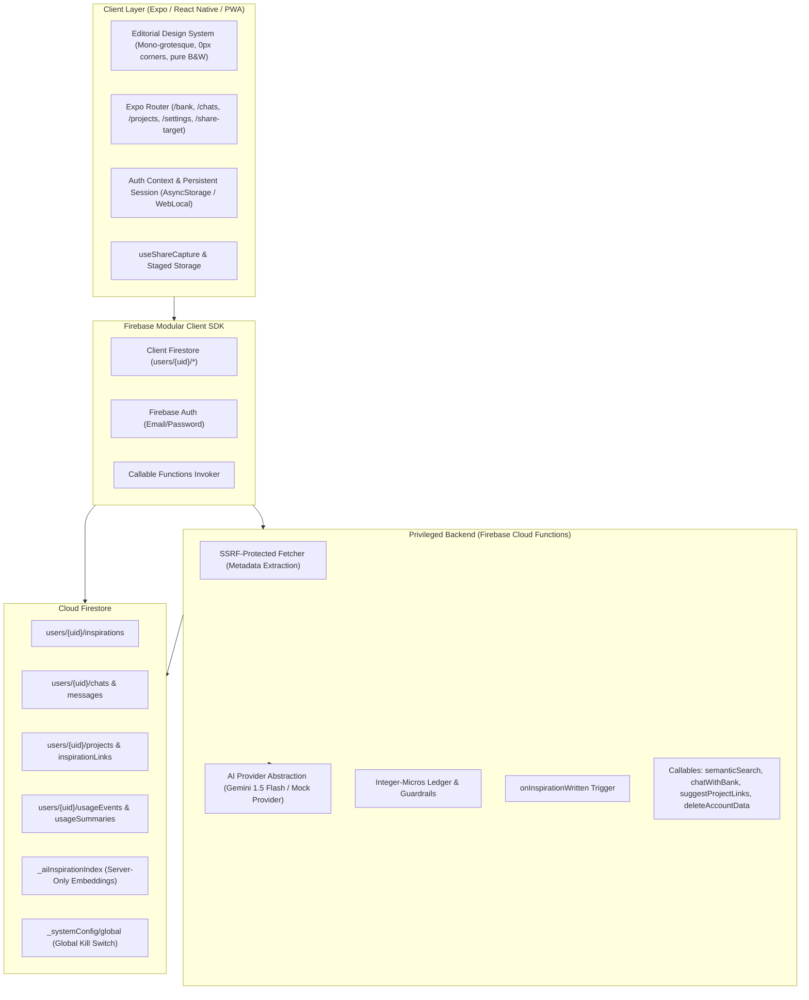

# System Architecture: rut

## 1. High-Level Architecture Overview

`rut` is a cross-platform inspiration bank engineered for private ideation, semantic AI indexing, exploratory chat trains of thought, and thematic project organization.

---

## 2. Core Architectural Pillars

### Pillar 1: Total Separation of Privileged AI & Secrets
- **No AI API Keys in Client Code**: All embedding generation, prompt construction, and LLM inference run exclusively inside Cloud Functions.
- **Zero Access to `.env.local`**: The environment boundary is strictly enforced. Expo CLI commands run with `EXPO_NO_DOTENV=1`.
- **Server-Only Vector Collection**: Embeddings are stored in `_aiInspirationIndex`. Security rules reject all client read/write attempts.

### Pillar 2: Visual Discipline (`DESIGN.md`)
- Pure black `#000000` on pure white `#ffffff`.
- Radius vocabulary of `0px` everywhere, with exactly one exception: the `24px` announcement pill.
- Non-Seasonal Geo / Inter mono-grotesque typography with exact `-0.48px` hero tracking.
- Error red `#db1215` reserved strictly for validation error states.
- Flat elevation (`0px` box shadow).

### Pillar 3: Universal Incoming Share Capture
- Native Android `SEND` intents and iOS custom schemes (`rut://share`) route to `/share-target`.
- PWA `share_target` declared in `manifest.json`.
- Unauthenticated shares are safely staged in local storage until the user authenticates, then restored for confirmation.
- Binary media (videos, photos) are intentionally rejected with clear explanations.

### Pillar 4: Traceable AI Reasoning (Trains of Thought)
- Chats represent isolated exploration workspaces.
- AI answers must cite exact inspiration IDs from the user's bank.
- Responses render interactive `SourceCard` components allowing one-tap navigation to source material.
- Useful insights can be promoted to a `Project` with a single click.

### Pillar 5: Cost Accounting in Integer Micros
- Every AI operation calculates cost server-side in integer micros (`$1 = 1,000,000 micros`).
- Tracks input tokens, output tokens, and character counts against a versioned pricing table.
- Guardrails cap daily spend at 2,000,000 micros ($2.00) and 500 requests per user.
- A global kill switch in `_systemConfig/global` provides instant operational circuit-breaking.

---

## 3. Documentation Map & Deep-Dives

| Document | Purpose & Scope |
|---|---|
| **[GOOGLE_USAGE.md](GOOGLE_USAGE.md)** | Comprehensive guide on Google Cloud, Firebase 2nd Gen, and Gemini AI services used across `rut`. |
| **[SHARING.md](SHARING.md)** | Multi-platform incoming share pipeline (Android intents, iOS share extension, PWA share target). |
| **[COST_ESTIMATE_20261018_010900.md](COST_ESTIMATE_20261018_010900.md)** | Unit economics, per-user monthly estimates, and fleet scale projections. |
| **[COST_SAFETY_GUARDRAILS.md](COST_SAFETY_GUARDRAILS.md)** | Step-by-step operational guide for adjusting budget limits, kill-switches, and billing alerts. |
| **[SECURITY_SCAN_20261017_165100.md](SECURITY_SCAN_20261017_165100.md)** | Automated dependency vulnerability scan and Red Team Firestore security rules audit. |
| **[COST_AUDIT.md](COST_AUDIT.md)** | Historical operational read/write analysis and Firestore budget breakdowns. |

