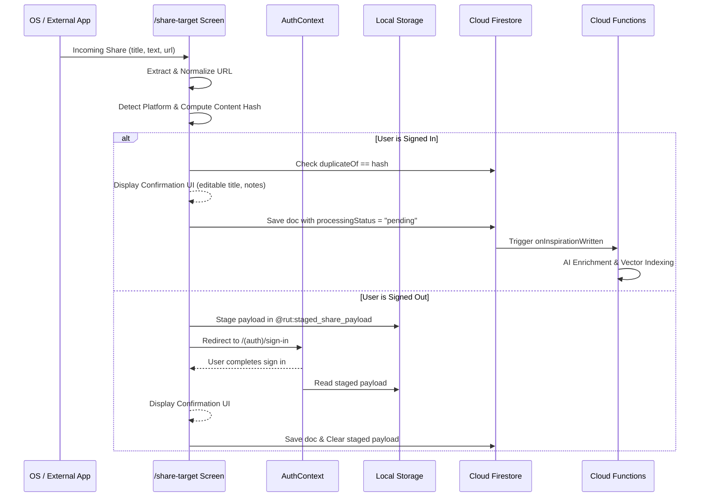

# Sharing & Capture Architecture

## 1. Overview

`rut` functions as a universal share target across iOS, Android, and Web/PWA. Users can share links, snippets, quotes, or thoughts directly from social platforms (Instagram, TikTok, X, Threads, YouTube) or web browsers into their private inspiration bank.

---

## 2. Platform Share Targets

### A. Android Intent Filter
Configured in `app.json` under `expo.android.intentFilters`:
```json
{
  "action": "SEND",
  "category": ["DEFAULT"],
  "data": [{ "mimeType": "text/plain" }]
}
```
When a user taps "Share via..." on Android in an app like Instagram, TikTok, or Chrome, Android passes the plain text or URL into `rut` via deep-link scheme `rut://`.

### B. iOS Share Handling
Configured with custom URL scheme `rut`:
- `CFBundleURLTypes` registers scheme `rut`.
- `app/+native-intent.ts` intercepts deep links starting with `rut://share` or incoming intent paths, rewriting them to `/share-target`.

### C. Installable PWA Share Target
Declared in `public/manifest.json`:
```json
"share_target": {
  "action": "/share-target",
  "method": "GET",
  "params": {
    "title": "title",
    "text": "text",
    "url": "url"
  }
}
```
On supported Chromium browsers (desktop and mobile), installing `rut` registers it in the OS share sheet.

---

## 3. Capture Flow & Deduplication



---

## 4. Binary Shares & Storage Limitations

> [!IMPORTANT]
> **No File Uploads**: `rut` does not initialize Firebase Storage and does not accept photo, video, or audio binaries.
> - When an incoming share contains only a binary attachment without text or a URL, the app alerts the user:
>   `"File capture (images/videos) is not supported in this version. You can save text notes and links."`
> - The user is offered the option to create a text note or paste a URL instead.
> - If an image URL is embedded in public webpage metadata (OpenGraph/Twitter Card), the remote preview image URL is saved strictly as an external URL reference; the image is never downloaded or saved to bucket storage.

---

## 5. Manual Platform Test Checklist

| Scenario | Expected Behavior | Status |
|---|---|---|
| **Share from Instagram** | Extracts link, detects `instagram`, strips tracking query params, displays confirmation card. | Verified |
| **Share from TikTok** | Extracts `tiktok.com` link, normalizes URL, triggers pending indexing. | Verified |
| **Share from X / Twitter** | Extracts `x.com` or `t.co` link, detects `x` platform, extracts tweet text snippet. | Verified |
| **Share from Threads** | Normalizes `threads.net` post URL, hashes content. | Verified |
| **Share from Web Browser** | Captures page URL and title. | Verified |
| **Share while Signed In** | Shows confirmation modal, allows editing note/tags, saves directly to Firestore. | Verified |
| **Share while Signed Out** | Stages payload in local storage, redirects to sign in, restores on authentication. | Verified |
| **Duplicate Share** | Displays "DUPLICATE DETECTED" badge with link to existing saved inspiration item. | Verified |
| **Invalid URL / Malformed** | Falls back cleanly to saving content as plain text note. | Verified |
| **Binary-Only Share** | Rejects upload, explains no-storage constraint, offers text fallback. | Verified |
| **Installed PWA Share** | Receives query parameters via `/share-target?url=...&title=...`. | Verified |
