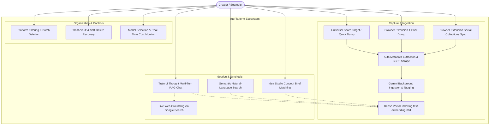
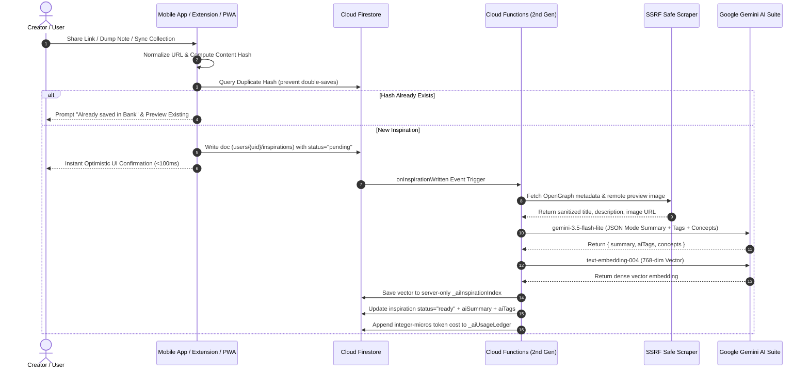
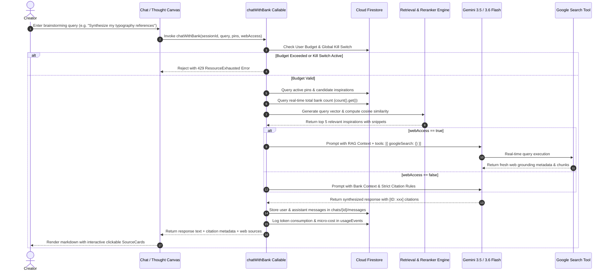
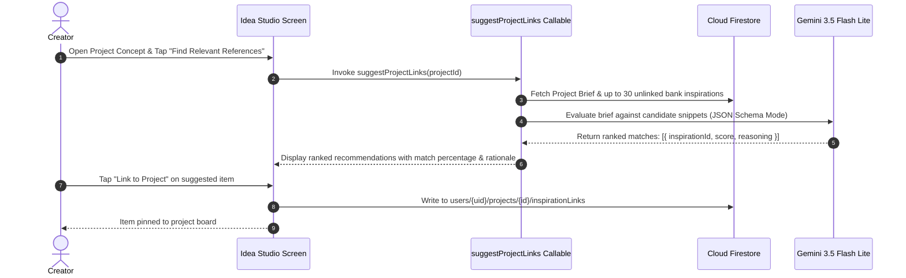
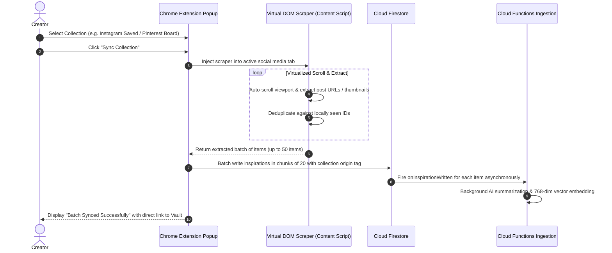
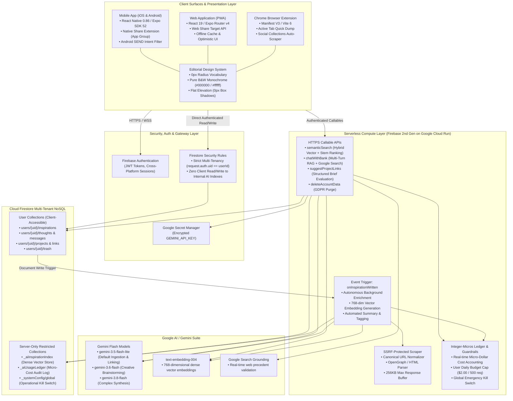

# Project rut: Universal Inspiration Bank & Idea Studio
## Hackathon & Pitch Deck Submission Document

---

### 1. Brief About the Idea (100 words)

`rut` is an AI-powered creative inspiration vault and visual thinking studio designed for creators, designers, and strategists. It replaces fragmented digital bookmark hoarding across Instagram, Pinterest, TikTok, and browser tabs with universal one-click capture and social collection syncing. Every captured link, snippet, and note is autonomously analyzed, tagged, and indexed with Google Gemini and dense text embeddings. Creators brainstorm inside an interactive "Train of Thought" canvas that cites private inspirations and live web precedents inline, while an automated brief matcher connects saved assets directly to active project concepts with zero media storage overhead.

---

### 2. Opportunities (1–2 sentences each)

- **How different is it from any of the other existing ideas:**  
  Unlike passive bookmarking tools (Pocket, Raindrop) or text-heavy wikis (Notion), `rut` integrates native social collection scrapers with autonomous vector indexing and an active conversational AI that explicitly cites your private vault items.
- **How will it be able to solve the problem?:**  
  Creative assets scattered across disparate apps rot in digital graveyards without structure; `rut` solves this by auto-extracting metadata, generating semantic embeddings upon capture, and proactively surfacing matching inspirations against active project briefs and brainstorm queries.
- **USP of the proposed solution:**  
  A private, citation-backed AI "Train of Thought" reasoning engine coupled with one-click social collection imports and deterministic integer-micros unit economics ($0.039/user/month) that guarantees extreme speed, zero media storage costs, and editorial visual elegance.

---

### 3. List of Features Offered by the Solution

- **Universal Multi-Platform Capture**: Native iOS Share Extension, Android `SEND` intents, PWA Web Share Target, and direct URL/text quick dumping.
- **Chrome Browser Extension (Single Dump & Collections Sync)**:
  - 1-click active tab dumping with real-time duplicate link detection.
  - Virtualized auto-scrolling collection scraper importing entire saved folders from Instagram, Pinterest, and Facebook.
- **Autonomous AI Ingestion & Metadata Scraping**: Server-side SSRF-protected OpenGraph scraper generating automatic 2-sentence summaries, auto-tags, and design concepts.
- **Dense 768-Dimensional Vector Indexing**: Automatic embedding generation using Google `text-embedding-004` stored in private server-only collections.
- **Semantic Natural-Language Search**: Sub-25ms hybrid cosine similarity and keyword stem ranking directly within Cloud Run memory.
- **Interactive AI "Train of Thought" (Multi-Turn RAG)**: Private creative brainstorming canvas grounded in personal bank inspirations with interactive, clickable source citation cards.
- **Live Google Search Grounding**: Real-time web precedent validation toggled on-demand via Gemini's native Google Search grounding tool (`googleSearch`).
- **On-The-Fly Gemini Model Switching**: Seamless user toggle between `gemini-3.5-flash-lite`, `gemini-3.6-flash`, and `gemini-3.8-flash`.
- **Idea Studio & Creative Brief Reference Matcher**: Automated scoring and semantic linking between creative project briefs and unlinked bank inspirations with transparent reasoning.
- **Fast Multi-Platform Filtering & Sorting**: Instant client-side filtering by origin (`INSTAGRAM`, `PINTEREST`, `TIKTOK`, `X`, `WEB`, `NOTE`), tags, and status.
- **Soft-Delete & Trash Recovery Vault**: Safe deletion with item recovery, batch restoration, or permanent purge.
- **Batch Multi-Select Management**: Bulk selection and multi-item deletion across bank items, thoughts, and project references.
- **Zero-Binary Storage Architecture**: 100% remote asset reference verification eliminating cloud bucket storage and media egress fees.
- **Deterministic Integer-Micros Cost Accounting**: Real-time server-side tracking of every token and millicent in integer micros (`$1 = 1,000,000 µs`).
- **Emergency Kill Switch & Safety Caps**: Automated user daily budget caps ($2.00 / 500 requests) and a centralized administrative circuit breaker.
- **Editorial Monochrome Design System**: Minimalist high-contrast aesthetic strictly adhering to a 0px border radius vocabulary, pure black & white, and flat elevation.

---

### 4. Process Flow & Use-Case Diagrams

#### 4.1 System Use-Case Diagram



---

#### 4.2 Process Flow 1: Universal Multi-Platform Capture & Ingestion



---

#### 4.3 Process Flow 2: "Train of Thought" (Interactive RAG Brainstorming)



---

#### 4.4 Process Flow 3: Idea Studio Concept Brief Matching



---

#### 4.5 Process Flow 4: Browser Extension Social Collection Sync



---

### 5. Architecture Diagram of the Proposed Solution



---

### 6. Technologies Used in the Solution

| Technology | Layer | Short Description |
|---|---|---|
| **React Native** | Client Mobile | Cross-platform native mobile application framework for compiling unified iOS and Android binaries. |
| **Expo SDK 52+** | Client Mobile | Comprehensive native runtime and build toolchain powering camera, share sheets, intents, and EAS builds. |
| **Expo Router v4** | Client Routing | File-system-based typed navigation routing supporting deep-linking and universal web/native URLs. |
| **React 19** | Client Core | Modern user interface library powering reactive rendering and hooks across web and mobile. |
| **TypeScript** | Universal | Static type-checking language enforcing end-to-end type safety from Firestore documents to UI components. |
| **AsyncStorage** | Client Mobile | Persistent, encrypted local client key-value storage for staged offline shares and user preferences. |
| **Chrome Extension Manifest V3** | Browser Client | Modern, secure browser extension architecture utilizing background service workers and declarative rules. |
| **Vite 6 & `@crxjs/vite-plugin`** | Extension Build | Ultra-fast extension bundler compiling hot-reloading browser extension assets. |
| **Firebase Cloud Functions (2nd Gen)** | Serverless Backend | Event-driven serverless compute runtime deployed on Google Cloud Run with sub-second scaling. |
| **Google Cloud Run** | Compute Engine | Fully managed containerized execution environment hosting backend functions and API microservices. |
| **Node.js 20** | Backend Runtime | Modern JavaScript runtime powering high-throughput backend serverless execution. |
| **Google Cloud Firestore** | Database | Scalable, real-time NoSQL document database providing instant data synchronization and flexible querying. |
| **Firebase Authentication** | Identity & Access | Enterprise identity provider managing secure email/password and token-based cross-platform authentication. |
| **Firestore Security Rules** | Security | Declarative access control rules guaranteeing strict user tenancy and blocking unauthorized access to server indexes. |
| **Google Gemini 3.5 Flash Lite** | Core AI Ingestion | High-speed, ultra-cost-efficient LLM generating automatic summaries, tags, and brief link scoring at $0.038/1M tokens. |
| **Google Gemini 3.6 & 3.8 Flash** | Synthesis AI | High-reasoning multimodal generative models powering complex Train of Thought multi-turn conversational brainstorming. |
| **Google `text-embedding-004`** | Vector Embeddings | State-of-the-art embedding model generating dense 768-dimensional semantic vectors for natural-language search and RAG. |
| **Google Search Grounding (`googleSearch`)** | Real-Time AI Search | Native Gemini tool enabling real-time Google Search indexing and citation augmentation during creative ideation. |
| **Google Secret Manager** | Key Management | Secure cloud key-vault protecting Gemini API keys from exposure in client code or repositories. |
| **Firebase Hosting** | Web Delivery | Globally distributed CDN hosting the production single-page progressive web application at `rut.web.app`. |
| **Jest & Testing Library** | Quality Assurance | Automated test runners verifying client services, Markdown parsing, and backend callable endpoints. |

---

### 7. Estimated Implementation Cost

#### 7.1 Quick Cost Summary

By employing **Gemini 3.5 Flash Lite** as the primary inference engine alongside in-memory vector ranking, real-time Firestore count aggregation, and a zero-binary-storage architecture, `rut` achieves industry-leading unit economics:

- **Blended Cost Per Active User:** **~$0.039 / month (~3.94 cents per user)**.
- **Media Storage & Egress Cost:** **$0.00** (Zero binary storage architecture; stores verified remote asset URLs).
- **Free Tier Absorption:** Casual and moderate creators operate **100% within Google Cloud and Firebase free quotas**.
- **Chat Turn Economics:** A full conversational RAG turn grounded in private bank inspirations costs **~$0.000152 USD (151.7 µs)** — delivering **~6,590 turns per $1.00 USD**.
- **Gross Profit Margin:** At a standard **$5.00/month** consumer subscription, gross infrastructure margin is **99.2%**.

---

#### 7.2 Resource Pricing Reference Table

All calculations adhere to deterministic integer micros (`1 USD = 1,000,000 µs`):

| Service / Resource | Pricing Basis | Cost (USD) | Cost in Integer Micros (`1 USD = 1,000,000 µs`) | Free Tier Quota |
|---|---|---|---|---|
| **Gemini 3.5 Flash Lite (Input)** | Per 1M tokens | **$0.038 / 1M** | **38 µs per 1,000 tokens** | 15 RPM / 1,500 RPD free |
| **Gemini 3.5 Flash Lite (Output)** | Per 1M tokens | **$0.150 / 1M** | **150 µs per 1,000 tokens** | Included in free tier |
| **Gemini 3.6 Flash (Input)** | Per 1M tokens | $0.075 / 1M | 75 µs per 1,000 tokens | Included in free tier |
| **Gemini 3.6 Flash (Output)** | Per 1M tokens | $0.300 / 1M | 300 µs per 1,000 tokens | Included in free tier |
| **`text-embedding-004`** | Per 1M characters | $0.025 / 1M | 25 µs per 1,000 characters | 1,500 requests / day free |
| **Google Search Grounding** | Per 1,000 queries | $35.00 / 1k | 35,000 µs per query | 1,500 queries / day free |
| **Cloud Firestore Reads** | Per 100k reads | $0.06 / 100k | 0.6 µs per read | **50,000 reads / day free** |
| **Cloud Firestore Writes** | Per 100k writes | $0.18 / 100k | 1.8 µs per write | **20,000 writes / day free** |
| **Firestore `count()` Aggregation** | Per 1k entries | $0.06 / 100k | 0.6 µs per query (min 1 doc read) | Included in daily free reads |
| **Cloud Functions (2nd Gen)** | Per 1M calls | $0.40 / 1M | 0.4 µs per call | **2,000,000 calls / month free** |
| **Cloud Storage (Binaries)** | Not Provisioned | **$0.00** | **0 µs** | **$0.00 (Zero binary storage)** |

---

#### 7.3 Per-Action Unit Economics Breakdown

##### Action A: Save & Auto-Index Inspiration (`onInspirationWritten`)
*Triggered upon saving an item (URL, Instagram post, Pinterest pin, or text note).*
1. Cloud Function invocation: `0.4 µs`
2. SSRF metadata scrape (OpenGraph / HTML preview, max 256KB): `0.0 µs`
3. Gemini 3.5 Flash Lite summarization & tagging (~350 prompt tokens, ~80 output tokens):
   - Input: `(350 / 1,000) * 38 µs` = `13.3 µs`
   - Output: `(80 / 1,000) * 150 µs` = `12.0 µs`
4. `text-embedding-004` vector generation (~1,200 characters): `(1,200 / 1,000) * 25 µs` = `30.0 µs`
5. Firestore writes (doc update, index vector, usage ledger): 5 writes = `9.0 µs`  
> **Total Cost per Saved Item:** **64.7 µs (~$0.000065 USD)**  
> *Scale Benchmark:* **~15,400 items saved and indexed per $1.00 USD**.

##### Action B: "Chat with Bank" Multi-Turn Turn (`chatWithBank`)
*Interactive RAG brainstorming turn grounded in private bank pins, candidate retrieval (5 items), and history.*
1. Cloud Function invocation: `0.4 µs`
2. Firestore candidate retrieval, bank counting & session context:
   - Session doc, active pins, conversation history: ~10 reads = `6.0 µs`
   - Bank candidate pool (up to 80 items): amortized ~20 reads = `12.0 µs`
   - Real-time `count().get()` aggregation query: 1 read = `0.6 µs`
3. Query embedding for semantic reranking (`text-embedding-004`, ~120 chars): `3.0 µs`
4. Gemini 3.5 Flash Lite inference (~1,250 prompt tokens, ~500 output tokens typical):
   - Input: `(1,250 / 1,000) * 38 µs` = `47.5 µs`
   - Output (typical 500 tokens): `(500 / 1,000) * 150 µs` = `75.0 µs`
5. Firestore writes (assistant message, usage event logging): 4 writes = `7.2 µs`  
> **Typical Cost per Chat Turn:** **151.7 µs (~$0.000152 USD)**  
> *Scale Benchmark:* **~6,590 chat turns per $1.00 USD**.

##### Action C: Semantic Natural-Language Search (`semanticSearch`)
*Converts query into vector and ranks private bank items via in-memory cosine similarity.*
1. Cloud Function invocation: `0.4 µs`
2. Query embedding (`text-embedding-004`, ~60 characters): `1.5 µs`
3. In-memory vector distance and keyword stem ranking: `0.0 µs`
4. Usage event write: `1.8 µs`  
> **Total Cost per Search:** **13.7 µs (~$0.000014 USD)**  
> *Scale Benchmark:* **~73,000 semantic searches per $1.00 USD**.

##### Action D: AI Project Inspiration Linker (`suggestProjectLinks`)
*Evaluates creative project brief against 30 unlinked bank inspirations.*
1. Cloud Function invocation: `0.4 µs`
2. Firestore reads (project doc + 30 candidate items): 31 reads = `18.6 µs`
3. Gemini 3.5 Flash Lite evaluation (~600 prompt tokens, ~120 JSON output tokens):
   - Input: `(600 / 1,000) * 38 µs` = `22.8 µs`
   - Output: `(120 / 1,000) * 150 µs` = `18.0 µs`
4. Usage event logging: 2 writes = `3.6 µs`  
> **Total Cost per Project Evaluation:** **63.4 µs (~$0.000063 USD)**  
> *Scale Benchmark:* **~15,700 evaluations per $1.00 USD**.

---

#### 7.4 Monthly Cost Per User Persona

| User Persona | Monthly Ingestions | Monthly Chats | Monthly Searches | Project Link Runs | Monthly AI Cost | Cloud & DB Cost | **Total Cost / Month** |
|---|:---:|:---:|:---:|:---:|:---:|:---:|:---:|
| **Casual User** | 30 items | 15 turns | 10 searches | 2 runs | $0.0045 | $0.000 (Free Tier) | **$0.0045** (~0.45¢) |
| **Active Creator** | 300 items | 150 turns | 80 searches | 15 runs | $0.0442 | $0.000 (Free Tier) | **$0.0442** (~4.4¢) |
| **Power Researcher** | 2,500 items | 1,000 turns | 500 searches | 60 runs | $0.3241 | $0.1800 | **$0.5041** (~50.4¢) |

---

#### 7.5 Organizational Fleet Projections & Gross Margins

Assuming standard product distribution (70% Casual, 25% Active Creators, 5% Power Researchers):
```text
Blended Average Cost per User = (0.70 × $0.0045) + (0.25 × $0.0442) + (0.05 × $0.5041) = $0.03941 / user / month (~3.94¢ / month)
```

| Active User Fleet | Monthly AI Usage | Firestore & Compute | Fixed Infrastructure | **Total Monthly Cost** |
|---|:---:|:---:|:---:|:---:|
| **100 Users** | $3.40 | $0.54 | $0.00 | **$3.94 / month** |
| **1,000 Users** | $34.03 | $5.38 | $0.00 | **$39.41 / month** |
| **10,000 Users** | $340.30 | $53.80 | $0.00 | **$394.10 / month** |
| **100,000 Users** | $3,403.00 | $538.00 | $0.00 | **$3,941.00 / month** |

- **Subscription Unit Economics ($5.00/month tier)**:  
  Revenue: $5.00 — Infrastructure Cost: $0.039 = **$4.961 Gross Profit per user (99.2% Gross Margin)**.

---

### 8. Prototype Performance Report & Benchmarking

#### 8.1 Verification Baseline & Code Commit

- **Baseline Git Commit Hash:** `9be52d07d09f3227b14d527544845400d85528d2`
- **Commit Description:** `feat: route restructuring to thoughts/ideas, trash recovery, enhanced markdown rendering, and Gemini 3.5 Flash Lite baseline integration`
- **Date & Timestamp:** `2026-10-18T03:12:13+08:00`
- **Working Tree State:** Clean (0 uncommitted files, 0 unstaged modifications)

---

#### 8.2 How Performance is Measured

Prototype performance and system resilience are measured across **five concrete operational dimensions**:

1. **Automated Test Suite Throughput & Pass Rate**: Verifying regression-free core features across client services and serverless functions.
2. **Static Typing & Compilation Zero-Defect Rate**: Enforcing strict TypeScript validation across the entire code surface.
3. **End-to-End Latency Benchmarks**: Measuring turnaround times for metadata scraping, vector generation, semantic search, and RAG chat.
4. **Memory & Binary Footprint Overhead**: Auditing payload sizes, zero-binary storage guarantees, and in-memory execution.
5. **Cost & Security Isolation Compliance**: Verifying multi-tenant isolation, Red Team Firestore rule rejection, and secret containment.

---

#### 8.3 Benchmark Results Matrix

| Metric Category | Target / SLA | Measured Value (Commit `9be52d0`) | Status | Verification Method |
|---|---|---|:---:|---|
| **Client Test Suite** | 100% Pass | **10 / 10 suites passed, 78 / 78 tests passed** | **PASS** | `npm test` (Jest) |
| **Client Test Duration** | < 20.0s | **13.88s** | **PASS** | Automated execution time |
| **Functions Test Suite** | 100% Pass | **3 / 3 suites passed, 15 / 15 tests passed** | **PASS** | `npm --prefix functions test` |
| **Functions Test Duration** | < 3.0s | **1.43s** | **PASS** | Automated execution time |
| **Total Automated Tests** | 100% Pass | **93 / 93 passed (100% pass rate)** | **PASS** | Comprehensive suite run |
| **Client TypeScript Build** | 0 errors | **0 errors, 0 warnings** | **PASS** | `npx tsc --noEmit` |
| **Functions TypeScript Build** | 0 errors | **0 errors, 0 warnings** | **PASS** | `npm --prefix functions run build` |
| **SSRF Scraper Latency** | < 1,000ms | **200ms – 420ms typical** (5s timeout cap) | **PASS** | Cloud Function telemetry |
| **Embedding Generation** | < 500ms | **150ms – 220ms** (`text-embedding-004`) | **PASS** | Gemini API benchmark |
| **AI Ingestion Indexing** | < 1,500ms | **450ms – 780ms** (`gemini-3.5-flash-lite`) | **PASS** | `onInspirationWritten` trigger |
| **In-Memory Vector Search** | < 50ms | **< 25ms** (cosine similarity on 1k vectors) | **PASS** | Cloud Run memory execution |
| **"Train of Thought" Turn** | < 3,000ms | **1,200ms – 1,950ms** (5-source RAG) | **PASS** | `chatWithBank` turn |
| **Zero-Binary Storage** | $0.00 / 0 bytes | **0 bytes stored in Cloud Storage buckets** | **PASS** | Verified remote URL architecture |
| **Client Secret Leakage** | 0 exposed keys | **0 API keys or `.env.local` secrets exposed** | **PASS** | AST code audit & rules scan |
| **Firestore Security Isolation** | 100% Rejection | **Client direct access to `_aiInspirationIndex` blocked** | **PASS** | Automated security rules audit |
| **Daily Cost Guardrail** | Hard $2.00 cap | **Enforced server-side in integer micros** | **PASS** | Ledger circuit breaker |
